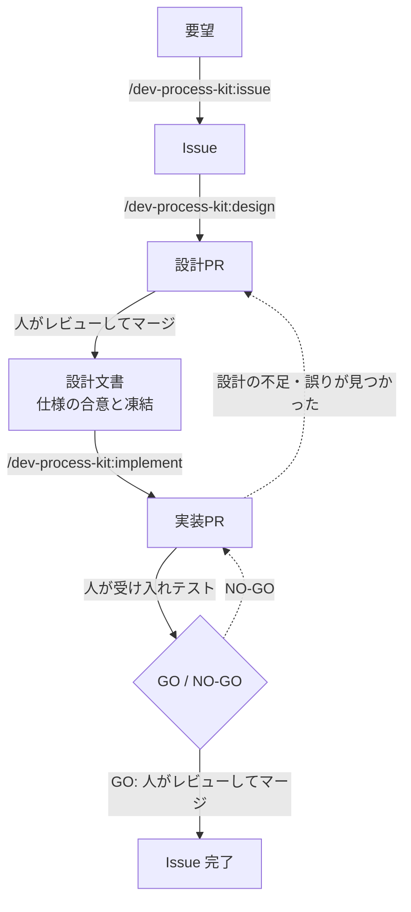

# dev process kit

[English](README.md) | 日本語

Software development process skills for AI coding agents; like a spec-driven-development.

AI コーディングエージェント向けの開発プロセス系スキルをまとめたプラグインです。Claude Code・Codex・GitHub Copilot CLI にはこのリポジトリをマーケットプレイスとして追加して、Antigravity には GitHub の URL を指定して導入できます。

仕様駆動開発（SDD）より広く、要件定義から受け入れテストまでのソフトウェア開発プロセスを支援します。日本のウォーターフォール開発を下敷きに、要望を Issue で管理し、設計 PR のマージで仕様を凍結してから実装に入ります。実装中に仕様の問題が見つかれば、上流の設計に戻って直します。

## スキル

要望を Issue に記録し、設計文書で仕様を合意してから、Issue ごとに1つの PR で実装する、という流れを3つのスキルで進めます。

| スキル | 役割 |
| :--- | :--- |
| `issue` | 要望を GitHub Issue に起票する。リポジトリの Issue テンプレートがあれば従う |
| `design` | Issue を `requirements.md`・`specification.md`・`architecture.md`・`tests.md` の4文書に設計し、設計 PR を作る |
| `implement` | マージ済みの設計文書をもとに、Issue 1つにつき1つの実装 PR で実装する |

どの設計文書をどのレベルの検証で確かめるかという対応と、ユニットテスト・インテグレーションテスト・シナリオテストそれぞれの定義（ユニットテストを実装より先に書くテスト駆動開発（TDD）を含む）は、このプラグインが決めます。PR の書式、テストフレームワークやツール、品質ゲートの方法は決めません。リポジトリの規約と利用者の指示に従います。詳しくは [dev-process-kit の思想](docs/philosophy.ja.md) を参照してください。

## 開発の流れ



各工程の詳しい進め方は [Getting Started](docs/getting-started.ja.md) を、なぜこの流れなのかは [dev-process-kit の思想](docs/philosophy.ja.md) を参照してください。

## 対応ハーネス

| ハーネス | マーケットプレイス定義 | プラグインマニフェスト |
| :--- | :--- | :--- |
| Claude Code | `.claude-plugin/marketplace.json` | `plugins/dev-process-kit/.claude-plugin/plugin.json` |
| Codex | `.agents/plugins/marketplace.json` | `plugins/dev-process-kit/.codex-plugin/plugin.json` |
| GitHub Copilot CLI | `.github/plugin/marketplace.json` | `plugins/dev-process-kit/plugin.json` |
| Antigravity | — | `plugins/dev-process-kit/plugin.json` |

GitHub Copilot CLI では、プロジェクトや個人のスキルに `issue`・`design`・`implement` と同じ名前のものがあると、このプラグインのスキルは警告なしに使われなくなります。

## 導入方法

```sh
# Claude Code
claude plugin marketplace add neko3cs/dev-process-kit
claude plugin install dev-process-kit@dev-process-kit

# Codex
codex plugin marketplace add neko3cs/dev-process-kit
codex plugin add dev-process-kit@dev-process-kit

# GitHub Copilot CLI
copilot plugin marketplace add neko3cs/dev-process-kit
copilot plugin install dev-process-kit@dev-process-kit

# Antigravity（AGY CLI 1.3.3 以上）
agy plugin install https://github.com/neko3cs/dev-process-kit/plugins/dev-process-kit
```

## 更新方法

```sh
# Claude Code
claude plugin marketplace update dev-process-kit
claude plugin update dev-process-kit@dev-process-kit

# Codex
codex plugin marketplace upgrade dev-process-kit

# GitHub Copilot CLI
copilot plugin update dev-process-kit
```

## ドキュメント

| ドキュメント | 内容 |
| :--- | :--- |
| [Getting Started](docs/getting-started.ja.md) | 導入から、1つの要望を Issue → 設計 PR → 実装 PR まで通す流れ |
| [dev-process-kit の思想](docs/philosophy.ja.md) | なぜウォーターフォールの工程で進めるのか、このプラグインが決めること・決めないこと |
| [スキルリファレンス](docs/skills.ja.md) | `issue`・`design`・`implement` が何を読み、何を作り、何をしないか |

## ライセンス

[MIT](LICENSE)。ただし、ユニットテストの根拠として置いている[講演の要約](plugins/dev-process-kit/skills/implement/references/tdd-bootcamp-2020-wada.md)は対象外です。第三者の講演を要約したもので、内容の権利は登壇者と主催者にあります。
