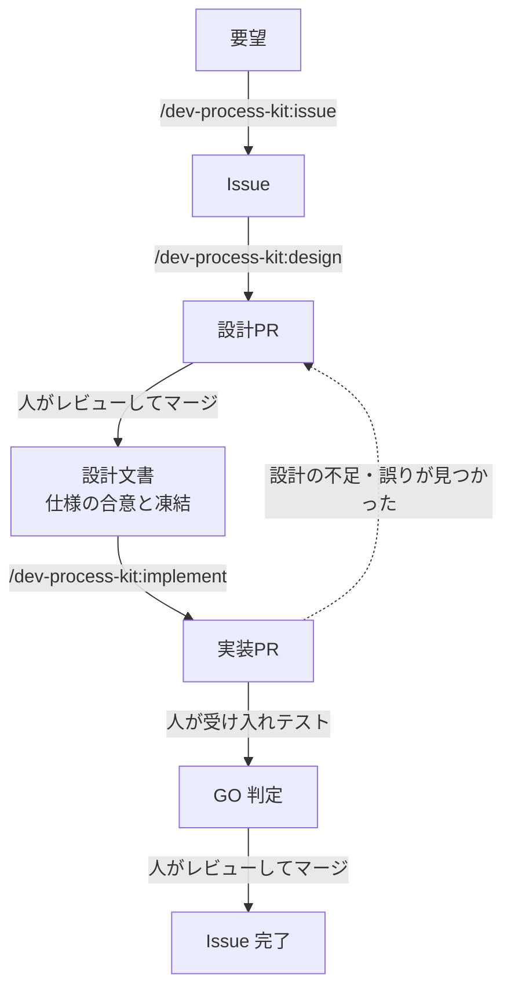

# dev process kit

Software development process skills for AI coding agents; like a spec-driven-development.

AI コーディングエージェント向けの開発プロセス系スキルをまとめたプラグインです。Claude Code と Codex の両方に、このリポジトリをマーケットプレイスとして追加すれば導入できます。

## スキル

要望を Issue に記録し、設計文書で仕様を合意してから、Issue ごとに1つの PR で実装する、という流れを3つのスキルで進めます。

| スキル | 役割 |
| :--- | :--- |
| `issue` | 要望を GitHub Issue に起票する。リポジトリの Issue テンプレートがあれば従う |
| `design` | Issue を `requirements.md`・`specification.md`・`architecture.md` の3文書に設計し、設計 PR を作る |
| `implement` | マージ済みの設計文書をもとに、Issue 1つにつき1つの実装 PR で実装する |

どの設計文書をどのレベルの検証で確かめるか（業務要件はシナリオテストと受け入れテスト、仕様はインテグレーションテスト、アーキテクチャは構造による強制とレビュー、詳細設計はユニットテスト）という対応は、このプラグインが決めます。PR の書式、実装の進め方、テストフレームワークやツール、品質ゲートの方法は決めません。リポジトリの規約と利用者の指示に従います。

## 開発の流れ



| 工程 | スキル | 内容 |
| :--- | :--- | :--- |
| 起票 | `issue` | 要望を Issue に残す。何を作るかの合意や受け入れ基準はここでは決めない |
| 設計 | `design` | Issue を3つの設計文書に落とし込み、設計 PR を作る。未決の箇所は仮案で書き、PR コメントで質問する |
| 設計の合意 | — | 人が設計 PR をレビューしてマージする。マージで仕様が合意され、凍結される |
| 実装 | `implement` | 合意済みの設計文書だけを実装し、Issue 1つにつき1つの実装 PR を作る。判断待ちがあるあいだは Draft のままにする |
| 受け入れテスト | — | 人が `requirements.md` の受け入れ基準に照らして受け入れテストをし、GO / NO-GO を判断する |
| 実装の合意 | — | 人が実装 PR をレビューしてマージする。マージで Issue が完了する |

実装の途中で設計の不足や誤りが見つかったら、実装 PR の中で仮案にせず、実装を止めて別の設計 PR で直します。その設計 PR がマージされてから実装を再開します。正しい動作がすでに設計文書に書かれているバグ修正は、設計を経ずに `implement` から始められます。

## 対応ハーネス

| ハーネス | マーケットプレイス定義 | プラグインマニフェスト |
| :--- | :--- | :--- |
| Claude Code | `.claude-plugin/marketplace.json` | `plugins/dev-process-kit/.claude-plugin/plugin.json` |
| Codex | `.agents/plugins/marketplace.json` | `plugins/dev-process-kit/.codex-plugin/plugin.json` |

## 導入方法

```sh
# Claude Code
claude plugin marketplace add neko3cs/dev-process-kit
claude plugin install dev-process-kit@dev-process-kit

# Codex
codex plugin marketplace add neko3cs/dev-process-kit
codex plugin add dev-process-kit@dev-process-kit
```

## 更新方法

```sh
# Claude Code
claude plugin marketplace update dev-process-kit
claude plugin update dev-process-kit@dev-process-kit

# Codex
codex plugin marketplace upgrade dev-process-kit
```

## ライセンス

[MIT](LICENSE)
