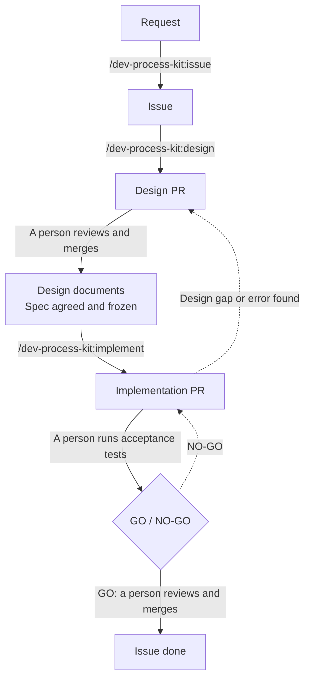

# dev process kit

English | [日本語](README.ja.md)

Software development process skills for AI coding agents; like a spec-driven-development.

dev-process-kit is a plugin that bundles development process skills for AI coding agents. On Claude Code, Codex, and GitHub Copilot CLI, add this repository as a marketplace; on Antigravity, install it from its GitHub URL.

It supports a wider part of the software development process than spec-driven development (SDD): from requirements definition to acceptance testing. Modeled on the waterfall process used in Japanese software development, it tracks requests as Issues and freezes the specification when the design PR is merged, before implementation starts. If a problem with the specification turns up during implementation, work goes back upstream to the design to fix it.

## Skills

Three skills carry the flow: record a request in an Issue, agree on the specification in design documents, then implement with one PR per Issue.

| Skill | Role |
| :--- | :--- |
| `issue` | Files a request as a GitHub Issue, following the repository's Issue templates if there are any |
| `design` | Designs an Issue into three documents (`requirements.md`, `specification.md`, `architecture.md`) and opens a design PR |
| `implement` | Implements from the merged design documents, with one implementation PR per Issue |

This plugin decides which design document is verified at which level of testing, and that tests are written before the implementation (test-driven development, TDD). It does not decide PR format, test frameworks and tools, or how to run quality gates; those follow the repository's conventions and the user's instructions. See [Philosophy](docs/philosophy.md) for details.

## Development flow



See [Getting Started](docs/getting-started.md) for how each step works, and [Philosophy](docs/philosophy.md) for why the flow is shaped this way.

## Supported harnesses

| Harness | Marketplace definition | Plugin manifest |
| :--- | :--- | :--- |
| Claude Code | `.claude-plugin/marketplace.json` | `plugins/dev-process-kit/.claude-plugin/plugin.json` |
| Codex | `.agents/plugins/marketplace.json` | `plugins/dev-process-kit/.codex-plugin/plugin.json` |
| GitHub Copilot CLI | `.github/plugin/marketplace.json` | `plugins/dev-process-kit/plugin.json` |
| Antigravity | — | `plugins/dev-process-kit/plugin.json` |

On GitHub Copilot CLI, if a project or personal skill has the same name as `issue`, `design`, or `implement`, this plugin's skill is silently no longer used.

## Install

```sh
# Claude Code
claude plugin marketplace add neko3cs/dev-process-kit
claude plugin install dev-process-kit@dev-process-kit

# Codex
codex plugin marketplace add neko3cs/dev-process-kit
codex plugin add dev-process-kit@dev-process-kit

# GitHub Copilot CLI
copilot plugin marketplace add neko3cs/dev-process-kit
copilot plugin install dev-process-kit@dev-process-kit

# Antigravity (AGY CLI 1.3.3 or later)
agy plugin install https://github.com/neko3cs/dev-process-kit/plugins/dev-process-kit
```

## Update

```sh
# Claude Code
claude plugin marketplace update dev-process-kit
claude plugin update dev-process-kit@dev-process-kit

# Codex
codex plugin marketplace upgrade dev-process-kit

# GitHub Copilot CLI
copilot plugin update dev-process-kit
```

## Documentation

| Document | Contents |
| :--- | :--- |
| [Getting Started](docs/getting-started.md) | From installation to taking one request through Issue → design PR → implementation PR |
| [Philosophy](docs/philosophy.md) | Why the work follows waterfall phases, and what this plugin decides and leaves to you |
| [Skill reference](docs/skills.md) | What `issue`, `design`, and `implement` read, produce, and do not do |

## License

[MIT](LICENSE)
